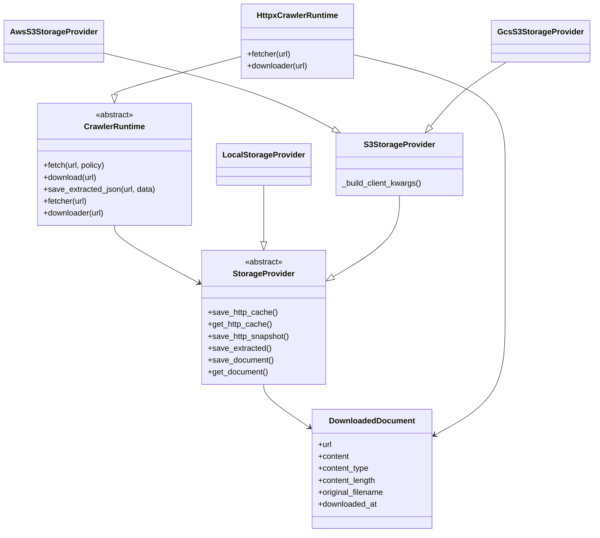

# Runtime Design

This document describes the current runtime implementation and class relationships.

Unlike architectural documents, this design may evolve as new runtime requirements emerge.

## Purpose

The crawler runtime is responsible for:

- applying cache policies
- orchestrating network access
- persisting artifacts
- downloading documents
- delegating storage concerns to a storage backend

The runtime intentionally remains independent from:

- filesystem layout
- S3 implementation
- plugin-specific business logic

Storage concerns are delegated to a `StorageProvider`.

## Main Components



## Responsibilities

### CrawlerRuntime

Responsible for:

- cache policy application
- cache statistics
- change detection
- document download orchestration
- extracted data persistence

Not responsible for:

- path construction
- S3 key generation
- filesystem management

### HttpxCrawlerRuntime

Responsible for:

- HTTP requests
- redirects
- response validation
- retrying transient HTTP infrastructure failures
- detecting localized server errors (HTTP 500) through a reference page health check
- document downloading

Not responsible for:

- storage
- cache persistence

### Transient HTTP Failures

Target websites may become temporarily unavailable (maintenance windows, gateway micro-outages).
Instead of failing immediately, `HttpxCrawlerRuntime.fetcher` retries such requests.

Retried status codes (default):

- 502 Bad Gateway
- 503 Service Unavailable
- 504 Gateway Timeout

Any other HTTP status code (e.g. 404) and network-level errors (DNS, connection, timeout) fail
immediately. An HTTP 500 is a special case: it is first validated with a health check, as described
below.

#### Localized page bugs (HTTP 500) vs. global outages

Unlike 502/503/504 (always infrastructure-related), an HTTP 500 can be specific to a broken target
URL (application bug). Retrying a single broken page would only block the crawler queue, so
`HttpxCrawlerRuntime.fetcher` performs an immediate health check before deciding:

1. **Trigger:** the target URL returns an HTTP 500.
2. **Action:** a lightweight `CheckPage` request is sent to a reference page. The reference page is,
   in order of preference: the last successfully fetched page, the configured `base_url`, or the
   root domain of the target URL.
3. **Decision:**
   - **`CheckPage` responds normally (no 5xx):** the issue is local to the target URL. The crawler
     fails immediately without retry and raises `LocalServerErrorException`.
   - **`CheckPage` returns a 5xx or is unreachable:** the whole website is down or in maintenance.
     The standard retry mechanism (exponential backoff) applies to the target URL.

The health check is performed for every health-check status code (500 by default) and its request is
not counted as a retry of the target URL.

#### Retry schedule

Each retry waits longer than the previous one (exponential backoff). Default schedule:

| Attempt | Delay before attempt |
| ------- | -------------------- |
| 1       | 0s (immediate)       |
| 2       | 30s                  |
| 3       | 60s                  |
| 4       | 120s                 |
| 5       | 300s                 |
| 6       | 3600s                |

The delay before attempt `N` is the item `N - 1` of `DEFAULT_RETRY_DELAYS_SECONDS`, so the maximum
number of attempts is `len(DEFAULT_RETRY_DELAYS_SECONDS) + 1` (6).

#### Configuration

Retry configuration is centralized in the runtime:

- `HttpxCrawlerRuntime(retryable_status_codes=..., retry_delays_seconds=..., health_check_status_codes=...)`
  for explicit overrides.
- `RANKING_HTTP_RETRY_STATUS_CODES` environment variable to override the retryable status codes
  without code change (comma-separated list, e.g. `502,503,504,429`). When unset or empty, the
  default list is used. Invalid values raise a `ValueError`.
- `RANKING_HTTP_RETRY_DELAYS_SECONDS` environment variable to override the backoff schedule
  (comma-separated delays in seconds, in retry order, e.g. `30,60,120,300,3600`). When unset or
  empty, the default schedule is used. The number of delays defines the maximum number of attempts:
  `len(delays) + 1`. Decimals are accepted (e.g. `0.5,1,2`). Invalid values raise a `ValueError`.
- `RANKING_HTTP_HEALTH_CHECK_STATUS_CODES` environment variable to override the status codes
  triggering a reference page (`CheckPage`) health check (comma-separated list, e.g. `500`). When
  unset or empty, the default list (`500`) is used. Invalid values raise a `ValueError`.

If both the constructor argument and the environment variable are set, the constructor argument
wins.

Backoff sleeps are accounted for in `sleep_duration_seconds` and reported in the crawl summary, like
the random pre-fetch sleep.

### Temporary unavailable pages (fake `200 OK`)

Some websites answer `200 OK` while actually serving a temporary maintenance page (e.g. a page
displaying "On revient très vite !"). Such a page must not be cached nor snapshotted, since it does
not represent the real content.

Plugins may flag these pages through the `is_temporary_unavailable_page(url, content)` hook. The
default implementation (`ranking.core.crawler.runtime.default_is_temporary_unavailable_page`) always
returns `False`, so plugins that do not implement the hook keep their existing behavior unchanged.

A hook returning `True` is handled like a transient failure:

- the page is never cached nor snapshotted;
- the request is retried through the same backoff schedule and attempt limit as 502/503/504;
- if the maintenance page persists after the maximum number of attempts, the fetch fails with a
  `RuntimeError` (handled by the CLI as a regular `fetch_error`).

The hook is wired into the runtime by the CLI (`build_cache`), following the same pattern as
`normalize_for_comparison`.

### StorageProvider

Responsible for:

- URL canonicalization
- Resource ID generation
- artifact persistence
- artifact retrieval

Not responsible for:

- HTTP requests
- cache decisions
- parsing

### DownloadedDocument

DownloadedDocument represents the logical document exchanged between2the runtime and the storage
provider. A downloaded document contains:

- content
- metadata
- source URL

The storage backend is responsible for persisting this information.

## Design Rationale

The runtime uses dependency injection:

```text
CrawlerRuntime
    ↓
StorageProvider
```

allowing storage implementations to be replaced without affecting crawler logic.

Examples:

```text
LocalStorageProvider
AwsS3StorageProvider
GcsS3StorageProvider
```

The runtime interacts only with URLs. Concepts such as:

- Resource IDs
- filesystem paths
- S3 object keys

remain internal implementation details of the storage provider.

## S3-Compatible Storage Providers

The runtime supports multiple S3-compatible storage backends.

Common S3 storage behavior is implemented in `S3StorageProvider`.

Provider-specific implementations customize boto3 client configuration through the
`_build_client_kwargs()` extension hook.

Current implementations:

- AwsS3StorageProvider
- GcsS3StorageProvider

This design keeps all storage behavior centralized while allowing provider-specific client
configuration.
