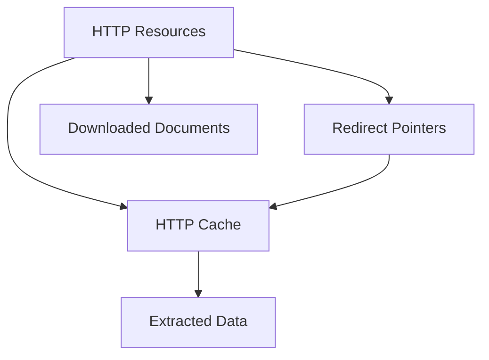

# Storage strategy

## Purpose

The crawler persists several categories of artifacts.

Each category serves a different purpose and may have different retention policies in the future.

The storage model must remain independent from the physical storage backend.

Supported storage backends include:

- Local filesystem
- Amazon S3

Future backends may be added without impacting plugin logic.

## Storage Backend Responsibilities

A storage backend is responsible for:

- persisting artifacts
- retrieving artifacts
- persisting metadata
- mapping Resource IDs to physical resources

Storage backends must remain transparent to plugins.

## Logical Storage Areas

The storage model is organized around logical storage areas.

These logical areas are independent from the physical storage implementation (local filesystem, S3,
or future backends).

The system currently manages four logical storage areas:

- HTTP Cache
- Redirect Pointers
- Extracted Data
- Downloaded Documents

Logical storage areas describe the role of stored artifacts.

The same logical area may be implemented differently depending on the storage backend.



## URL-Based Identity

All storage areas rely on the same deterministic URL identity mechanism.

```text
URL
 ↓
Canonicalization
 ↓
SHA1
 ↓
Resource ID
```

The same URL must always generate the same Resource ID.

### Canonicalization

Before hash generation:

- query parameters are parsed
- parameters are sorted
- the URL is rebuilt in canonical form

This guarantees that semantically equivalent URLs generate the same Resource ID.

### Hash Algorithm

The hashing algorithm used in v1 is **SHA‑1**, applied to the UTF‑8 encoded URL.

The goal is deterministic mapping, not cryptographic security.

### Stability

Resource ID generation must remain stable across runs to preserve cache usability and storage
consistency

## HTTP Cache

### Purpose

The HTTP cache avoids re-fetching already downloaded HTTP resources during crawling. It enables:

- offline replay
- safe long-runnning execution
- deterministic behvior across runs

The cache is **not** a performance optimization layer and **not** a data storage system.

Examples:

- event pages
- race pages
- result detail pages

### Characteristics

- deterministic URL → resource mapping
- replayable
- cache policies supported
- snapshots supported

### Authoritative

No.

The source remains the target website. Cached resources may be refreshed or invalidated.

### Scope

The HTTP cache applies only to **raw HTTP responses**.

Typical resources include:

- HTML pages
- text resources

The cache stores raw HTTP responses and remains agnostic of resource semantics.

When using `REFRESH_AND_CACHE`, a plugin-provided normalization step may be applied before comparing
fetched and cached content.

This normalization is:

- transient
- used only for change detection
- never persisted

### Cache Policies

Cache behavior is explicitly defined at call time.

Supported policies:

- **NO_CACHE**
  - Always fetch from the network.
  - No cache read or write.
  - Used when fresh data is required and caching is undesirable.

- **CACHE_IF_PRESENT**
  - Use cached content if available and not flagged as a temporary unavailable page (see below).
  - Otherwise fetch and store the response.
  - Used for stable pages (results, detail pages).

- **REFRESH_AND_CACHE**
  - Always fetch from the network.
  - Then **only when the fetched content differs from the** **currently cached version**:
    - Overwrite the active cache entry.
    - Keep a timestamped snapshot of the previous version (if it exists and is not flagged as a
      temporary unavailable page — see below) for debugging
  - Used for pages that must be refreshed regularly but still need replayability (e.g. event listing
    pages).

Cache decisions are **never implicit**.

### API

```python
fetch_page(url: str, cache_policy: CachePolicy) -> str
```

### Snapshots

Snapshots are created only when:

- using `REFRESH_AND_CACHE`
- content is detected as changed
- the previous version is not a temporary unavailable page (see below)

Snapshots are:

- write-only
- never automatically replayed
- intended for debugging and inspection

### Behavioral Rules

- Snapshot creation may use normalized content comparison.
- Raw content is always persisted without modification.
- The cache remains independent from parsing and normalization concerns.

### Temporary unavailable pages (fake `200 OK`)

Some target websites answer with a successful HTTP status (`200 OK`) while actually serving a
temporary maintenance page (e.g. a page displaying "On revient très vite !"). Such content must not
be treated as a valid HTTP resource.

Rule:

- flagged content is never cached nor snapshotted;
- a flagged cached entry is not a valid cache hit: it is treated as invalid, refetched and
  overwritten;
- a flagged previous version is never snapshotted by `REFRESH_AND_CACHE`.

Detection is delegated to plugins through the `is_temporary_unavailable_page` hook (see
`plugin_guidelines.md`). The retry mechanism applied when such a page is detected is described in
`design/runtime_design.md`.

### Non-Goals

Version 1 intentionally excludes:

- HTTP cache headers (ETag, Cache-Control, etc.)
- Time-based expiration (TTL)
- Partial invalidation (except the targeted, content-based invalidation of temporary unavailable
  pages described above)
- Concurrency or distributed cache

## Redirect Pointers

### Purpose

When a URL (A) redirects to another URL (B), the raw HTTP content must be stored **once**, under the
Resource ID of the final URL (B), which is the canonical identity of the resource. A lightweight
**redirect pointer** is stored for the initial URL (A) so that a later crawl can resolve A without
hitting the network.

This avoids duplication (the same content stored under several hashes) and keeps resource identity
consistent.

### Characteristics

- one small JSON artifact per redirecting URL, addressed by the Resource ID of the **initial** URL
  (A);
- it maps the initial URL (A) to the final URL (B) and stores both Resource IDs;
- pointers may form a chain (`A → B → C`); resolution follows the chain to the canonical URL;
- a pointer always takes precedence over a legacy HTTP cache body stored for the same URL;
- it is not authoritative: when the canonical cache entry is missing, the URL is considered a cache
  miss and is refetched (self-healing).

### Cache policy interaction

- `NO_CACHE`: no pointer is read or written.
- `CACHE_IF_PRESENT`: the pointer chain is resolved transitively (`A → B → C → ...`) to the
  canonical URL, and only that URL's cache entry is read. Intermediate and legacy bodies are never
  used. When the canonical entry is missing, or the chain is cyclic / exceeds `MAX_REDIRECT_HOPS`
  (default: 10), the URL is a cache miss and is refetched.
- `REFRESH_AND_CACHE`: the pointer is rewritten to the final URL reported by the HTTP client (which
  collapses chains to a single hop) and, once the canonical content is persisted, the redirecting
  URL's stale `current` body is removed. When A stops redirecting, a stale pointer is removed and A
  is stored as a direct body.
- For both cache-writing policies, pointer creation and stale-body cleanup apply only when A and B
  have different Resource IDs. If canonicalization gives them the same ID (for example, when only
  query-parameter order changes), remove any pointer at that ID and retain the canonical body
  without deleting it.
- Redirects to another domain are rejected by the HTTP runtime (`ExternalRedirectError`) and no
  pointer is created.

### Chain resolution

An alias may become stale when its target starts redirecting later (`A → B` stored, then `B → C`).
Resolution is therefore transitive:

- follow pointers until a URL without a pointer is reached; that URL is canonical;
- a pointer takes precedence over a legacy `current` body for the same URL;
- only the canonical URL's cache entry is read; intermediate and legacy bodies are never used;
- cycles, self-references and chains longer than `MAX_REDIRECT_HOPS` (default: 10) are invalid and
  treated as a cache miss;
- a successful fetch writes the pointer directly to the final URL, collapsing the chain.

Existing aliases are not rewritten eagerly, as that would require scanning every pointer on each
write. They remain valid through transitive resolution and collapse on their next refresh.

### Pointer format

The physical representation is backend-specific. The logical content is:

```json
{
  "url": "https://site/A",
  "target_url": "https://site/B",
  "resource_id": "<resource id of A>",
  "target_resource_id": "<resource id of B>",
  "created_at": "2026-11-11T09:00:00+00:00"
}
```

### Deletion

`delete-cache` is URL-scoped and never cascading. For a redirecting URL A it removes the pointer
`A → B` and, when present, A's own HTTP cache entry (legacy entry). It never deletes the canonical
content stored under B, which may be shared by other URLs.

### Non-Goals

Version 1 intentionally excludes cascading deletion: deleting a redirecting URL never deletes the
canonical content of its target.

## Extracted Data

### Purpose

Store raw extraction outputs.

Examples:

```json
{
  "races": [...],
  "documents": [...]
}
```

### Characteristics

- optional
- useful for debugging
- useful for functional test generation
- generated from cached HTTP resources

### Authoritative

No.

Extracted data can always be rebuilt from the HTTP cache.

## Downloaded Documents

### Purpose

Store downloadable artifacts discovered during crawling.

Examples:

- PDF rankings
- XLSX exports
- CSV exports

### Characteristics

- immutable once downloaded
- downloaded on demand
- identified by document URL

### Authoritative

Potentially.

Documents may have long-term value because they can disappear, be modified, or become inaccessible
on the source website.

### Metadata

Each downloaded document is associated with metadata.

The physical representation of the metadata is backend-specific.

The metadata includes:

- ressource_id
- url
- original_filename
- content_type
- content_length
- downloaded_at

## Local Filesystem Mapping

Current implementation.

```text
.cache/
└── <plugin_name>/
    ├── http/
    │   ├── current/
    │   └── snapshots/
    │
    ├── redirects/
    │
    └── extracted/

.documents/
└── <plugin_name>/
```

### HTTP Cache

```text
http/
└── current/
    └── 1c/
        └── 1c4230....html
```

### Snapshots

```text
http/
└── snapshots/
    └── 1c/
        └── 1c4230.../
            └── 2026-06-08T10-12-03.html
```

### Redirect Pointers

```text
redirects/
└── 1c/
    └── 1c4230....json
```

### Extracted

```text
extracted/
└── 1c/
    └── 1c4230....json
```

### Documents

The local filesystem implementation stores document metadata in a metadata.json file located
alongside the downloaded document in a directory using the Resource ID as name.

```text
.documents/
  plugin_name/
    1c/
      1c4230b146f1e14eae42b75a7b64f117e561dea7/
        official_file_name.ext
        metadata.json

    25/
      252659e0ea47a78c24a82acf647450add45ac9b3/
        another_official_file_name.ext
        metadata.json
```

## S3 Mapping

The filesystem and S3 layouts do not necessarily mirror each other exactly.

Both implementations expose the same logical storage areas while optimizing organization for their
respective backend

Example:

```text
s3://ranking/

<plugin_name>/
├── cache/
│   ├── http/
│   ├── redirects/
│   └── extracted/
│
└── documents/
```

The S3 layout uses plugin-centric prefixes, while the local filesystem layout uses artifact-centric
root directories.

The S3 implementation may store document metadata using S3 object metadata and/or dedicated metadata
objects.

Examples:

```text
s3://ranking/breizhchrono/cache/http/current/1c/1c4230....html
s3://ranking/breizhchrono/cache/redirects/1c/1c4230....json
s3://ranking/breizhchrono/cache/extracted/1c/1c4230....json
s3://ranking/breizhchrono/documents/1c/1c4230.../official_file_name.pdf
```

### Bucket Strategy

Version 1 uses a single bucket.

Example:

s3://ranking/

Logical separation is achieved through prefixes rather than multiple buckets.

## Retention Policy

Current rule: **Keep Everything**

Rationale:

- project is still exploring real-world data
- storage requirements are not yet known future retention strategies
- may differ per storage area

Retention policies will be defined later.

## Design Principles

- storage is independent from plugins
- storage is independent from parsing
- storage is independent from normalization
- storage backend must be replaceable
- URL identity must remain stable
- local filesystem and S3 share the same logical structure
